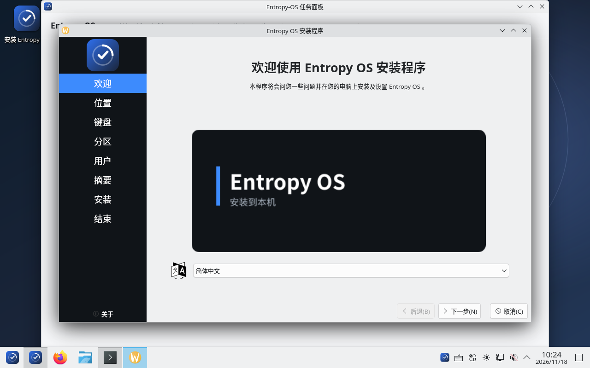
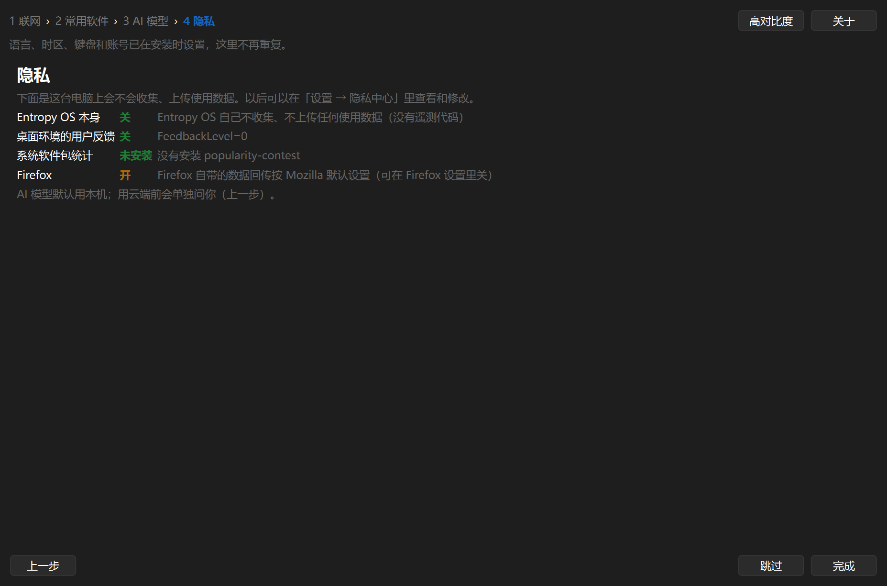

# Entropy OS（熵 OS）

[中文](#entropy-os熵-os) · [日本語](#日本語) · [English](#english)

Entropy OS 是基于 Debian 13（trixie）构建的桌面操作系统，自带本机运行的 AI 助手。

这个仓库只放说明、截图和链接，**不包含 Entropy OS 的源代码**。系统下载、开源组件的源码和用户协议都在 [lyrasama.com/os](https://lyrasama.com/os/)。

## 1.0 版

- **版本**：1.0，2026 年 11 月 22 日发布。基于 Debian 13（trixie）、Linux 6.12 和 KDE Plasma 6。
- **发布说明**：[中文](https://lyrasama.com/os/releases/1.0/RELEASE-NOTES.md)、[日本語](https://lyrasama.com/os/releases/1.0/RELEASE-NOTES.ja.md)、[English](https://lyrasama.com/os/releases/1.0/RELEASE-NOTES.en.md)
- **预装 Entropy Office**：文档、PDF、OFD、扫描与文字识别，不用另外安装。
- **三种界面语言**：中文、日文、英文；预装中文拼音输入和日文输入（Mozc）。
- **安装教程**：[lyrasama.com/os/install](https://lyrasama.com/os/install)（安装前请先看：选「抹除磁盘」会删除原有系统和文件；分区见[第 6.4 步](https://lyrasama.com/os/install#step-6-4)）
- **安装前请备份**：选择「抹除磁盘」会格式化整块硬盘，并删除原有系统和文件。
- **反馈**：[lyrasama.com/contact](https://lyrasama.com/contact)

## 核心特点

- **本地优先**：AI 助手默认使用本机模型，你的文件、屏幕内容和语音都在本机处理。云端模型默认关闭，要你单独同意才会用，并会先列出会发送哪些内容。
- **有 AI 更好，没有 AI 也能用**：没有独立显卡、或者还没下载模型时，系统、软件和文件操作都照常可用，助手功能等有了模型再打开。
- **不收集个人信息**：系统本身没有遥测代码，不收集、也不上传使用数据。随附的 Firefox 按 Mozilla 的默认设置向 Mozilla 发送数据，可以在 Firefox 设置里关闭。
- **执行前必须确认**：删除、覆盖、发送、安装等可能造成不可逆影响的操作，助手都要先得到你的确认。

## 版本

| | 个人版 | 企业版 |
|---|---|---|
| 适合 | 个人在自己的电脑上使用 | 公司、学校等单位统一部署 |
| 媒体格式 | 可以播放 AAC-LC 音频和 AMR 语音；HEVC、HEIC 不支持 | 编解码器按企业使用的许可范围构建，不含 AAC、AMR 等专利编解码器 |
| 全盘加密 | 安装时可选 | 安装时可选 |

## 系统要求

- UEFI 启动（不支持传统 BIOS），可以开着安全启动安装
- 64 位 x86（amd64）处理器，4 核以上
- 内存最少 2 GB，推荐 8 GB 以上；要用本机 AI 模型，建议 16 GB
- 硬盘最少 20 GB，推荐 64 GB 以上
- 推荐 Intel 或 AMD 显卡；要用本机 AI 模型的完整功能，推荐 6–8 GB 以上显存
- 4 GB 以上的 U 盘，用来制作安装盘（ISO 约 2.34 GiB）

本软件不是为交通工具运行和控制、医疗器械、核设施、关键基础设施控制等一旦出错可能危及生命或造成重大损害的用途设计的（用户协议第 7 条第 5 项）。

## 下载

请到 **[lyrasama.com/os](https://lyrasama.com/os/)** 下载。下载页上有：

- ISO 文件；
- SHA256 校验值、签名文件和签名公钥的指纹；
- 中文的 U 盘制作和校验步骤。

请只从这个地址下载，并在安装前核对校验值和签名。

## 已知问题

- 新款 NVIDIA 显卡的支持还没有验证过。系统默认用开源的 nouveau 驱动，不预装 NVIDIA 专有驱动。
- Microsoft UEFI CA 2011 证书已于 2026 年 6 月到期。镜像用的是同时带新旧两种签名的 shim，一般不受影响；很老的电脑开着安全启动无法启动时，请先更新主板固件。
- 安装程序里暂时不能使用中文和日文输入法。设置用户全名时请先用拉丁字母输入，安装完成后再到系统设置里修改。

## 开源组件

Entropy OS 包含许多开源软件，例如 Linux 内核、桌面环境、系统工具和安装器。它们按各自的许可提供：

- 许可证全文和版权声明：[lyrasama.com/os/notice](https://lyrasama.com/os/notice)
- GPL、LGPL 等许可要求的对应源码：[lyrasama.com/os/source/](https://lyrasama.com/os/source/)，每个版本至少保留三年

## 许可

- Entropy OS 本身是专有软件，按[用户协议](https://lyrasama.com/os/eula)提供，同时包含按各自许可提供的开源组件。用户协议不限制开源许可给你的任何权利。
- 本仓库的说明文字和截图按 CC BY-ND 4.0 提供（https://creativecommons.org/licenses/by-nd/4.0/ ）；其中出现的第三方商标、图标和界面元素归各自的权利人，不在此许可范围内。
- 著作权人：weisen

## 反馈

这个仓库**不受理 issue 和 pull request**。问题和建议请通过网站提交：[lyrasama.com/contact](https://lyrasama.com/contact)。反馈是匿名的，请不要填写个人信息。

## 声明

Entropy OS 不是 Debian 项目的产品，未获 Debian 项目或 SPI 的赞助、关联或认可。Debian 是 Software in the Public Interest, Inc. 的注册商标。

---

## 日本語

Entropy OS は、Debian 13（trixie）をベースにしたデスクトップ OS です。パソコン上で動く AI アシスタントを備えています。

このリポジトリには説明、スクリーンショット、リンクだけを置いています。**Entropy OS のソースコードは含まれていません。** ダウンロード、オープンソース部品のソースコード、使用許諾契約は [lyrasama.com/ja/os](https://lyrasama.com/ja/os/) にあります。

### 1.0

- **バージョン**：1.0（2026 年 11 月 22 日公開）。Debian 13（trixie）、Linux 6.12、KDE Plasma 6 がベースです。
- **リリースノート**：[日本語](https://lyrasama.com/os/releases/1.0/RELEASE-NOTES.ja.md)、[中文](https://lyrasama.com/os/releases/1.0/RELEASE-NOTES.md)、[English](https://lyrasama.com/os/releases/1.0/RELEASE-NOTES.en.md)
- **Entropy Office をプリインストール**：文書、PDF、OFD、スキャンと文字認識。別途インストールする必要はありません。
- **3 つの表示言語**：日本語、中国語、英語。日本語入力（Mozc）と中国語ピンイン入力をプリインストールしています。
- **インストール手順**：[lyrasama.com/ja/os/install](https://lyrasama.com/ja/os/install)（インストール前にお読みください。「ディスクを消去」を選ぶと既存のシステムとファイルは削除されます。パーティションは[6.4](https://lyrasama.com/ja/os/install#step-6-4)を参照）
- **インストール前にバックアップを**：「ディスクを消去」を選ぶとディスク全体がフォーマットされ、既存のシステムとファイルは削除されます。
- **フィードバック**：[lyrasama.com/ja/contact](https://lyrasama.com/ja/contact)

### 主な特長

- **ローカル優先**：アシスタントは初期設定でこのパソコン上のモデルを使い、ファイル、画面、音声はこのパソコンの中で処理します。クラウドのモデルは初期設定でオフで、送信する内容を一覧で示したうえで、あなたが同意した場合にだけ使います。
- **AI があればもっと便利、なくても使える**：グラフィックボードやモデルがなくても、システム、アプリ、ファイル操作はいつもどおり使えます。アシスタントはモデルが用意できてから有効になります。
- **個人情報を集めません**：システム自体にテレメトリのコードはなく、利用データを収集・送信しません。同梱の Firefox は Mozilla の初期設定に従って Mozilla にデータを送信します。Firefox の設定でオフにできます。
- **実行前に必ず確認**：削除、上書き、送信、インストールなど元に戻しにくい操作は、アシスタントが必ず先にあなたの確認を求めます。

### エディション

| | 個人版 | 企業版 |
|---|---|---|
| 対象 | 個人が自分のパソコンで使う | 会社や学校などの組織で一括導入する |
| メディア形式 | AAC-LC の音声と AMR の音声を再生できます。HEVC、HEIC には対応していません | コーデックは企業での利用に必要なライセンスの範囲で構築しています。AAC、AMR などの特許のあるコーデックは含みません |
| ディスク全体の暗号化 | インストール時に選択 | インストール時に選択 |

### 動作環境

- UEFI で起動（従来の BIOS には対応していません）。セキュアブートをオンにしたままインストールできます
- 64 ビットの x86（amd64）プロセッサー、4 コア以上
- メモリー 最低 2 GB、推奨 8 GB 以上。ローカルの AI モデルを使うなら 16 GB を推奨
- ストレージ 最低 20 GB、推奨 64 GB 以上
- Intel または AMD のグラフィックスを推奨。ローカルの AI 機能をすべて使うには、ビデオメモリー 6〜8 GB 以上を推奨
- インストール用に 4 GB 以上の USB メモリー（ISO は約 2.34 GiB）

本ソフトウェアは、交通機関の運行・制御、医療機器、原子力施設、重要インフラの制御など、故障が人の生命や重大な損害につながる用途向けに設計されていません（使用許諾契約 第 7 条第 5 号）。

### ダウンロード

**[lyrasama.com/ja/os](https://lyrasama.com/ja/os/)** からダウンロードしてください。ISO ファイル、SHA256 のチェックサム、署名ファイル、署名用公開鍵のフィンガープリント、USB メモリーの作り方と検証の手順を載せています。このアドレス以外からはダウンロードせず、インストールの前にチェックサムと署名を確認してください。

### 既知の問題

- 最近の NVIDIA グラフィックボードでの動作はまだ確認していません。初期設定ではオープンソースの nouveau ドライバーを使い、NVIDIA のプロプライエタリドライバーはプリインストールしていません。
- Microsoft UEFI CA 2011 の証明書は 2026 年 6 月に期限が切れました。イメージには新旧両方の証明書で署名された shim を使っているため、ほとんどのパソコンは影響を受けません。とても古いパソコンでセキュアブートをオンにして起動できない場合は、先にファームウェアを更新してください。
- インストーラーではまだ中国語と日本語の入力メソッドを使えません。フルネームはいったんローマ字で入力し、インストール後にシステム設定で変更してください。

### オープンソース部品

- ライセンスと著作権表示：[lyrasama.com/ja/os/notice](https://lyrasama.com/ja/os/notice)
- GPL、LGPL などのライセンスが求める対応するソースコード：[lyrasama.com/ja/os/source/](https://lyrasama.com/ja/os/source/)。各リリースについて少なくとも 3 年間提供します

### ライセンス

- Entropy OS 本体はプロプライエタリソフトウェアで、[使用許諾契約](https://lyrasama.com/ja/os/eula)に基づいて提供されます。それぞれのライセンスで提供されるオープンソース部品を含みます。使用許諾契約は、オープンソースのライセンスがあなたに与える権利を制限しません。
- このリポジトリの説明文とスクリーンショットは CC BY-ND 4.0 で提供します（https://creativecommons.org/licenses/by-nd/4.0/deed.ja ）。その中に含まれる第三者の商標、アイコン、画面要素はそれぞれの権利者に帰属し、このライセンスの対象外です。
- 著作権者：weisen

### フィードバック

このリポジトリでは **issue と pull request を受け付けていません**。ご意見や不具合はウェブサイトからお送りください：[lyrasama.com/ja/contact](https://lyrasama.com/ja/contact)。匿名のため、個人情報は書かないでください。

### Debian との関係について

Entropy OS は Debian プロジェクトの製品ではなく、Debian プロジェクトおよび SPI による後援、提携、承認を受けていません。Debian は Software in the Public Interest, Inc. の登録商標です。

---

## English

Entropy OS is a desktop operating system built on Debian 13 (trixie), with an AI assistant that runs on your own computer.

This repository contains only this description, screenshots and links. **It does not contain the source code of Entropy OS.** Downloads, the source code of the open-source components and the license agreement are at [lyrasama.com/en/os](https://lyrasama.com/en/os/).

### Version 1.0

- **Version:** 1.0, released on November 22, 2026. Based on Debian 13 (trixie), Linux 6.12 and KDE Plasma 6.
- **Release notes:** [English](https://lyrasama.com/os/releases/1.0/RELEASE-NOTES.en.md), [日本語](https://lyrasama.com/os/releases/1.0/RELEASE-NOTES.ja.md), [中文](https://lyrasama.com/os/releases/1.0/RELEASE-NOTES.md)
- **Entropy Office preinstalled:** documents, PDF, OFD, scanning and text recognition, nothing extra to install.
- **Three interface languages:** Chinese, Japanese and English, with Chinese Pinyin and Japanese (Mozc) input preinstalled.
- **How to install:** [lyrasama.com/en/os/install](https://lyrasama.com/en/os/install) (read this first: choosing "Erase disk" deletes the existing system and files; partitions are in [step 6.4](https://lyrasama.com/en/os/install#step-6-4))
- **Back up before installing:** choosing "Erase disk" formats the whole disk and deletes the existing system and files.
- **Feedback:** [lyrasama.com/en/contact](https://lyrasama.com/en/contact)

### Highlights

- **Local first.** The assistant uses a model on your computer by default; your files, screen and voice are processed locally. Cloud models are off by default and are used only after you agree, with a list of what would be sent.
- **Better with AI, fine without it.** Without a graphics card or a model, the system, apps and files work as usual; the assistant switches on once a model is available.
- **No personal data collected.** The system has no telemetry code and sends no usage data. The bundled Firefox sends data to Mozilla under Mozilla's default settings; you can turn this off in Firefox's settings.
- **Confirmation before action.** Deleting, overwriting, sending, installing and other actions that are hard to undo always ask you first.

### Editions

- **Personal:** for your own computer. Plays AAC-LC audio and AMR speech; HEVC and HEIC are not supported. Full-disk encryption is optional at installation.
- **Enterprise:** for organizations. Codecs are built for the licensing scope of business use, with no patent-encumbered codecs such as AAC and AMR. Full-disk encryption is likewise optional at installation.

### System requirements

- UEFI boot (legacy BIOS is not supported); Secure Boot can stay on
- 64-bit x86 (amd64) processor, 4 cores or more
- 2 GB of memory at least, 8 GB or more recommended; 16 GB for local AI models
- 20 GB of disk at least, 64 GB or more recommended
- Intel or AMD graphics recommended; 6–8 GB of video memory or more for the full local AI features
- A USB stick of 4 GB or more for the installer (the ISO is about 2.34 GiB)

The Software is not designed for uses where a failure could endanger life or cause serious damage, such as operating or controlling vehicles, medical devices, nuclear facilities or critical infrastructure (License Agreement, Article 7, item 5).

### Known issues

- Support for recent NVIDIA graphics cards has not been verified. The open-source nouveau driver is used by default; the proprietary NVIDIA driver is not preinstalled.
- The Microsoft UEFI CA 2011 certificate expired in June 2026. The image uses a shim signed with both the old and the new certificate, so most computers are not affected. If a very old computer will not boot with Secure Boot on, update its firmware first.
- Chinese and Japanese input methods do not work in the installer yet. Enter the full name in Latin letters, then change it in System Settings after installation.

### Open-source components

- Licenses and copyright notices: [lyrasama.com/en/os/notice](https://lyrasama.com/en/os/notice)
- Corresponding source code required by the GPL, LGPL and similar licenses: [lyrasama.com/en/os/source/](https://lyrasama.com/en/os/source/), kept for at least three years per release

### License

- Entropy OS itself is proprietary software, provided under its [license agreement](https://lyrasama.com/en/os/eula), and includes open-source components under their own licenses. The agreement does not limit any rights those open-source licenses give you.
- The text and screenshots in this repository are licensed under CC BY-ND 4.0 (https://creativecommons.org/licenses/by-nd/4.0/). Third-party trademarks, icons and interface elements shown in them belong to their respective owners and are not covered by this license.
- Copyright holder: weisen

### Feedback

This repository **does not accept issues or pull requests**. Please contact us through the website: [lyrasama.com/en/contact](https://lyrasama.com/en/contact). It is anonymous, so please don't include personal details.

### Notice

Entropy OS is not a product of the Debian Project and is not sponsored, affiliated with or endorsed by the Debian Project or SPI. Debian is a registered trademark of Software in the Public Interest, Inc.
